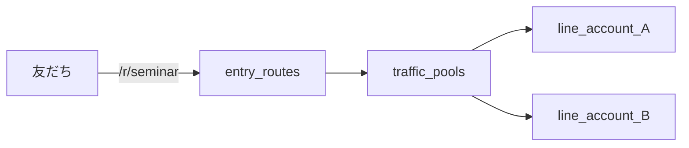

# 30. 動画機能プレイブック（OSS・LINE 中心）

YouTube「集客を完全0円で自動化」で紹介された **ウェビナー・マイル・マルチアカウント/プール** を、自前デプロイの L Harness OSS で再現する手順です。

前提: [Phase A デプロイ](../self-host/PHASE-A-DEPLOY.md) 完了、`node scripts/verify-self-host.mjs` が API まで通ること。

---

## Phase B — オートウェビナー（E2E）

### B-1. 管理画面でウェビナー作成

1. 管理画面 → **ウェビナー** → 新規作成
2. **スラッグ**（LIFF URL に使う）、**動画の長さ（分）**、**セッションスケジュール**（曜日・時刻）を設定
3. 必要なら **サクラコメント** JSON、**CTA**（フォーム or 外部 URL）を登録

### B-2. 動画を HLS に変換（ffmpeg）

MCP ツール `manage_webinar_video` の手順に従います（6 秒セグメント推奨）。Cursor で例:

> ウェビナー ID `{id}` に seminar.mp4 を HLS 変換してアップロードして

ローカルで ffmpeg する場合の骨子（詳細は `packages/mcp-server/src/tools/manage-webinar-video.ts`）:

```bash
# OUTDIR に master.m3u8 と 1080p/720p/... の seg_*.ts ができること
ffmpeg -i seminar.mp4 ... -hls_time 6 -master_pl_name master.m3u8 ...
```

**重要:** `master.m3u8` は **最後** にアップロードする（途中失敗でプレイリストだけ先に公開されないように）。

### B-3. LIFF で疑似ライブ確認

- LINE 友だちで LIFF を開く（巻き戻し UI なし・サーバー時刻基準の同期再生）
- 実装: [`apps/liff/src/pages/Webinar.tsx`](../../apps/liff/src/pages/Webinar.tsx)
- 30 秒ごとの heartbeat で **視聴位置（秒）** が Worker に送られる

### B-4. 視聴ログの確認

管理画面のウェビナー分析、または API `GET /api/webinars/{id}/analytics` で視聴者・到達率を確認。

### B-5. （任意）ライブ CTA 即時予約

[28-Google-Calendar-and-Webinar-Booking.md](28-Google-Calendar-and-Webinar-Booking.md) で Google Calendar OAuth → ウェビナー CTA から Meet + リマインド。

**成果物チェック**

- [ ] `video_prefix` / R2 に HLS が公開されている
- [ ] 1 セッション分、疑似ライブで最後まで視聴できる
- [ ] analytics に視聴位置が記録される

---

## Phase C — マイル制度

### C-1. ビルトインルール

マイグレーション `063_webinar_instagram_mileage.sql` で投入される既定ルール（管理画面 **マイル**）:

| ルール | イベント | 目安 |
|--------|----------|------|
| ウェビナー5分視聴 | `webinar_watch_5m` | +5 |
| 15分視聴 | `webinar_watch_15m` | +10 |
| **90% 視聴完了** | `webinar_completed` | +30 |
| CTA クリック | `webinar_cta_clicked` | +10 |

90% 判定: [`apps/worker/src/services/webinar-mileage.ts`](../../apps/worker/src/services/webinar-mileage.ts)（`position >= duration * 0.9`）。

### C-2. 追加ルール（任意）

管理画面 **マイル** で `form_submitted` / `affiliate_conversion_approved` 等を追加。友だちチャット右サイドバーに残高表示。

### C-3. 特典とオートメーション

- マイル閾値 → **タグ付与** → シナリオ分岐 / リッチメニュー切替（**オートメーション**）
- 「ブロックでマイル消失」は **マーケ文言・規約** で表現。技術的には ledger は残るため、**有効友だちのみ残高を見せる** UI 前提で運用。

### C-4. テスト

1. テスト友だちでウェビナーを 90% 以上視聴
2. **マイル** 画面の付与ログ / 友だち詳細のマイルを確認

**成果物チェック**

- [ ] `webinar_completed` でマイルが 1 回付与される（同一ウェビナーは subject 単位でユニーク）

---

## Phase D — マルチアカウント & プール（200 通 / BAN 分散）

### D-1. 複数 LINE 公式アカウント

**アカウント管理** で 2 つ目以降を登録（チャネル ID・トークン・シークレット）。詳細: [18-Multi-Account-and-BAN.md](18-Multi-Account-and-BAN.md)。

### D-2. トラフィックプール

**プール管理** で:

- `slug`（例: `main-pool`）
- `active_account_id`（現在の振り分け先）
- プールに複数 `line_accounts` を追加（MCP: `manage_traffic_pools`）

### D-3. 流入リンク（必須）

**プールだけ** 作っても流入画面に **(未登録)** と出ます。必ず **entry_routes** で `/r/{refCode}` を登録し、プール・タグ・起動シナリオを紐付けます。

- 管理画面: **リファラルリンク** / 流入設定
- MCP: `manage_entry_routes` + `manage_traffic_pools` を **セット**で使う



### D-4. 200 通/月の運用

- ダッシュボード **配信健全性** でクォータ残量を監視
- 上限接近時: プールの `active_account_id` を切替、または新無料アカウントをプールに追加
- BAN 検知時: wiki 18 の **アカウント移行** フロー

**成果物チェック**

- [ ] `/r/{ref}` がプール経由で友だち追加できる
- [ ] 2 アカウント以上がプールに入っている
- [ ] entry_route に ref が登録されている

---

## 管理画面ダッシュボード

デプロイ後、**ダッシュボード** 上部の「動画機能セットアップ」で 4 ステップの完了状況を確認できます。

## 参照

- 動画: https://www.youtube.com/watch?v=yBbjNHr_VQY
- Cloud 判断: [CLOUD-VS-OSS.md](../self-host/CLOUD-VS-OSS.md)
- Cursor MCP: [29-Cursor-Integration.md](29-Cursor-Integration.md)
